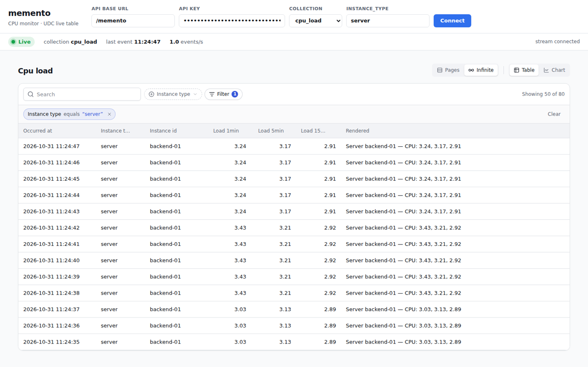

# jsmemento

[](https://github.com/digital-cube/jsmemento/actions/workflows/ci.yml)
[](https://github.com/digital-cube/jsmemento/actions/workflows/release.yml)

Self-hosted activity ledger: applications push machine events, memento keeps them as an
immutable, tenant-isolated audit trail and serves them back per entity, per actor, as a feed.
TypeScript port of Memento (Fastify + Drizzle + PostgreSQL + Redis).

| package | |
|---|---|
| [`@memento/core`](packages/core) | Zod schemas + inferred types, API key / scope helpers, Filter DSL, envelope |
| [`@memento/lookups`](packages/lookups) | `lookups.yaml` vocabulary, CSV translations, candidate recorder, TS/Zod codegen |
| [`@memento/server`](packages/server) | Fastify plugin & standalone server, Drizzle schema + migrations, Handlebars rendering, WebSocket stream, UDC collections |
| [`@memento/cli`](packages/cli) | `memento` CLI: setup wizard, tenants, API keys, templates, lookups, chats, `tail`, `cpu-monitor` |
| [`@memento/react`](packages/react) | React UI: `MementoProvider`, live event table, chat, search, hooks |
| [`apps/example`](apps/example) | Vite + React demo of `@memento/react`: paste a key, watch the live table |
| [`apps/cpu-monitor`](apps/cpu-monitor) | demo: `memento cpu-monitor` → the `cpu_load` UDC collection → a live `@jsudc/react` table |
| [`packages/e2e`](packages/e2e) | end-to-end suite: the built server ×2 against PostgreSQL + Redis (not published) |

## Run it with Docker

```bash
docker compose -f docker-compose.yaml up -d --wait      # memento :3000 + PostgreSQL + Redis
docker compose -f docker-compose.yaml exec memento memento create-tenant acme --name "Acme Inc"
docker compose -f docker-compose.yaml exec memento memento create-key --tenant acme --scopes read,write
curl localhost:3000/memento/api/health
```

Image: `ghcr.io/digital-cube/jsmemento:<version>` (`latest`, `main`). Environment variables,
volumes, reverse proxy and scaling: [docs/DEPLOYMENT.md](docs/DEPLOYMENT.md).

## Quick start (development)

Requires Node 24+ and pnpm. Details, tests and the release process:
[docs/CONTRIBUTING.md](docs/CONTRIBUTING.md).

```bash
cp .env.example .env            # adjust if needed; the server/CLI read the environment
docker compose up -d            # PostgreSQL + Redis (creates jsmemento and jsmemento_test)
pnpm install
pnpm db:migrate && pnpm db:migrate:test

pnpm memento create-tenant acme --name "Acme Inc"
pnpm memento create-key --tenant acme --scopes read,write --name local   # prints mk_… once
# (or, in a terminal: `pnpm memento setup` asks for the tenant and the key step by step)

pnpm dev                        # http://localhost:8000/memento
curl -X POST localhost:8000/memento/events -H "Authorization: Bearer mk_…" \
  -H 'content-type: application/json' \
  -d '{"event_type":"USER_LOGIN","instance_type":"user","instance_id":42,"actor_id":"igor"}'
curl "localhost:8000/memento/entities/user/42/events?locale=sr" -H "Authorization: Bearer mk_…"
# → "rendered": "Korisnik igor se prijavio."

# live stream of the tenant's events (any WebSocket client; key as subprotocol)
npx wscat -c "ws://localhost:8000/memento/ws?event_type=USER_LOGIN" -s memento.v1 -s "bearer.mk_…"

# the same from the CLI, like tail -f
MEMENTO_API_KEY=mk_… pnpm memento tail --chat-id chat-123      # [10:00:00] igor: Pozdrav!

# the React demo: live table, search, chat (proxies /memento to :8000)
cd apps/example && pnpm dev                                     # http://localhost:5173, paste the key

pnpm memento create-template --tenant acme --event-type USER_LOGIN --locale en \
  --body '{{upper actor_id}} signed in to Acme'          # per-tenant override
pnpm memento lookups validate                            # lookups.yaml + i18n/translations.csv
```

`.env` is not loaded automatically: export the variables (`set -a; . ./.env; set +a`) or rely
on the defaults, which match `compose.yaml`.

## Demo: live CPU monitor

The whole stack end to end — auth, event push, UDC, WebSocket, React — on one screen: the CLI
pushes this machine's load averages every second, the server serves them as the `cpu_load`
UDC collection (`POST /memento/udc/list`), and [`apps/cpu-monitor`](apps/cpu-monitor) draws
them with `@jsudc/react`, refreshed by the stream.

```bash
pnpm memento create-tenant demo --name Demo
pnpm memento create-key --tenant demo --scopes read,write --name cpu-monitor   # mk_…
pnpm memento cpu-monitor --interval 1 --tenant demo --key mk_…                 # terminal 2
cd apps/cpu-monitor && pnpm dev                                                # terminal 3, :5173
```

In the Docker stack the pusher is the optional `cpu-monitor` service (`docker compose -f
docker-compose.yaml --profile demo up -d`), which keeps the table live across restarts — see
[Demo pusher](docs/DEPLOYMENT.md#demo-pusher-profile-demo).



## Commands

| | |
|---|---|
| `pnpm build` / `pnpm typecheck` | Turbo over all packages |
| `pnpm test` / `pnpm test:coverage` | Vitest (server + CLI need PostgreSQL at `TEST_DATABASE_URL`); coverage ≥ 80 % per package, HTML in `packages/*/coverage/` |
| `pnpm test:e2e` | builds the server, runs two processes against PostgreSQL + Redis, tests HTTP + WebSocket |
| `pnpm lint` / `pnpm format` | Biome |
| `pnpm db:generate` | new Drizzle migration after editing `packages/server/src/db/schema.ts` |
| `pnpm memento lookups codegen` | regenerate typed lookups after editing `lookups.yaml` |

## Docs

- [docs/DEPLOYMENT.md](docs/DEPLOYMENT.md) — Docker image, `docker-compose.yaml`, environment variables
- [docs/CONTRIBUTING.md](docs/CONTRIBUTING.md) — dev setup, running tests, coverage, E2E, releasing
- [CHANGELOG.md](CHANGELOG.md) — releases
- [docs/API.md](docs/API.md) — endpoints with examples
- [docs/ARCHITECTURE.md](docs/ARCHITECTURE.md) — packages, database schema, request lifecycle
- [docs/TEMPLATES.md](docs/TEMPLATES.md) — rendering, locale fallback, tenant templates, lookups
- [docs/CHATS.md](docs/CHATS.md) — chats: messages, seen tracking, participants, permissions, CLI
- [docs/STREAMING.md](docs/STREAMING.md) — WebSocket `/memento/ws`: auth, filters, messages, slow consumers
- [docs/REACT.md](docs/REACT.md) — `@memento/react` components and hooks, the example app
- [docs/CLI.md](docs/CLI.md) — every `memento` command, prompts, `tail`, error messages
- [docs/ANALYSIS.md](docs/ANALYSIS.md), [docs/PHILOSOPHY.md](docs/PHILOSOPHY.md) — background
