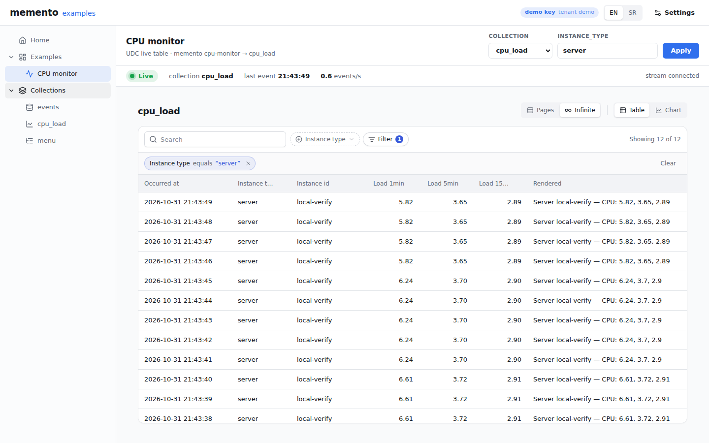

# memento examples

Every memento example behind one sidebar — the site `examples.stage.memento-service.org`
serves. A Vite + React 19 app on **`@jsudc/react`**: the sidebar is the **`menu` UDC
collection** (the repository's [`menu.yaml`](../../menu.yaml), served by `@memento/server`),
each example is a route, and every list on every page comes from UDC.



| route | page |
|---|---|
| `/` | redirect to the first example, `/examples/cpu-monitor` |
| `/examples/cpu-monitor` | [CPU monitor](#cpu-monitor) |
| `/examples/activity` | [Activity feed](#activity-feed) |
| `/examples/entity` | [Entity timeline](#entity-timeline): the picker |
| `/examples/entity/:instance_type/:instance_id` | the timeline of one instance (`ticket/T-17`, `user/ana`) |
| `/examples/chat` | [Chat](#chat): the simulator's demo room in `MementoChat`, viewed as one participant (`?as=ana`) |
| `/examples/tail`, `search`, `rendering`, `chart` | [planned](#planned-examples): what the example will show, a link back to the feed |
| `/udc/:collection` | a plain `UdcDataView` of any collection the server lists (`events`, `cpu_load`, `menu`) |
| anything else | redirect to `/` |

The server serves the built site at `/` and at `/en/` (the router's base is `/en` when the page
was opened there), so `…/en/` links keep working.

## Run it

Requires Node 24+, pnpm and the development infrastructure (PostgreSQL + Redis), from the
repository root:

```bash
docker compose up -d                        # PostgreSQL + Redis (compose.yaml)
pnpm install
pnpm db:migrate

# a tenant, a key for the pusher (write) and one for the page (read)
pnpm memento create-tenant demo --name Demo
pnpm memento create-key --tenant demo --scopes write --name cpu-monitor       # prints mk_… once
pnpm memento create-key --tenant demo --scopes read --name examples-demo      # prints mk_… once

# terminal 1: memento on http://localhost:8000/memento, handing the page its demo key
MEMENTO_DEMO_API_KEY=mk_…read… pnpm dev

# terminal 2: one CPU_LOAD event a second, and a ticket desk story (+ the chat room) for the feed
pnpm memento cpu-monitor --interval 1 --tenant demo --key mk_…write…
pnpm memento simulate --interval 1 --tenant demo --key mk_…write…

# terminal 3: the site
cd apps/examples && pnpm dev                # http://localhost:5173
```

The page opens the CPU monitor, already **Live**: with no key of its own it asks
`GET /memento/api/demo` and connects with the server's read-only demo key. Without
`MEMENTO_DEMO_API_KEY` that route answers 404 and the page asks for a key instead.

To run against the Docker stack (`docker-compose.yaml`, memento on :3000), start the page with
`MEMENTO_SERVER=http://localhost:3000 pnpm dev` — or skip Vite: the image serves the built site
at `http://localhost:3000/` (`MEMENTO_UI_DIR=/app/ui`), same origin as the API. Outside Docker:
`pnpm --filter @memento/examples build` and start the server with
`MEMENTO_UI_DIR=apps/examples/dist`.

## The shell

- **Sidebar** (`src/shell/MenuTree.tsx`, `src/shell/menu.ts`, ported from the jsudc example's
  shell): every row of the `menu` collection in one `useUdcAllRows` list, built into a tree;
  the leaf of the current route is highlighted and the way to it opened; what is open is kept in
  `localStorage` (`udc:menu:expanded`). Labels are `translation_key`s read through the site's
  messages (`src/i18n/messages.ts`, en + sr). The `Collections` branch is `udc:collections`,
  resolved by the server: `events`, `cpu_load`, `menu`. Without a key, without a `menu`
  collection, or when it cannot be read, the sidebar shows the built-in Home and
  Examples › CPU monitor entries (`BUILTIN_MENU_ROWS`).
- **Header**: the wordmark, which key is in use (**demo key** · tenant, **your key**, **no
  key**), the language (EN / SR) and **Settings**: API base URL and API key. The demo key is
  shown there, badged; paste your own to replace it (kept in `localStorage`), **Use the demo
  key** forgets yours again.
- **Routes**: react-router with `UdcReactRouterUrlState`, so every `UdcDataView` keeps its
  `?f=` (filter) / `?p=` (page) state in the URL.

## Adding an example

1. A page under `src/examples/<name>/`, routed in `src/App.tsx` (`/examples/<name>`, above the
   `/examples/:slug` route of the planned pages).
2. An entry under `EXAMPLES` in [`menu.yaml`](../../menu.yaml) (`url: /examples/<name>`), its
   `MENU.<TERM>` label (en + sr) in `src/i18n/messages.ts`, and the same entry in
   `BUILTIN_MENU_ROWS` (`src/shell/menu.ts`), which a test keeps equal to menu.yaml.
3. Replacing a planned example: drop its row from `PLANNED_EXAMPLES`
   (`src/examples/planned/planned.ts`) and add its url to `BUILT` in `test/planned.test.tsx`.

## Planned examples

Every example of the series is in `menu.yaml` already. The ones not built yet route to
`PlannedExamplePage` (`/examples/:slug`): a "Planned" badge, one paragraph on what the example
will show (`PLANNED_EXAMPLES`, slug → title and summary in EN and SR) and a link back to the
Activity feed. An unknown slug leads to `/`.

| slug | will show |
|---|---|
| `tail` | the WebSocket stream raw, with filters, like `memento tail` in the browser |
| `search` | `MementoSearch` with the Filter DSL JSON it sends to `POST /events/query` |
| `rendering` | one event, its EN and SR Handlebars templates and the result |
| `chart` | events per minute by type as a UDC chart |

## Chat

`memento simulate` also plays a chat: the team talks in one room, and the page shows that room
with **`MementoChat`** from `@memento/react` — the component an app would embed — read-only,
live.

```
memento simulate ──POST /chats (once), /chats/chat-demo-room/messages, /seen, /participants──▶ memento
                                                                                                 │
/examples/chat ◀── GET /chats/chat-demo-room?user_id=igor ── participants, read watermarks ──────┤
  MementoChat  ◀── GET /chats/chat-demo-room/messages?user_id=<viewer>&locale=<en|sr> ───────────┤
               ◀── ws /memento/ws?instance_type=chat&instance_id=chat-demo-room ─────────────────┘
```

- **The room.** On start the simulator makes sure `chat-demo-room` ("Demo room") exists,
  creating it with igor, marko, ana and jelena when it is missing (an existing one is reused).
  Its chat scene, weighted like the other scenes: an online member says a short line about the
  tickets the desk is working ("I took T-17.", "Zatvaram T-12, duplicate."), lines alternating
  English and Serbian as people write them (nothing is translated); another member marks the
  newest message seen; rarely somebody of the team is added. `--no-chat` leaves the room alone.
- **Viewed as a participant.** Chat reads are made on behalf of a user (`user_id`, see
  docs/CHATS.md), so the page reads the room as one participant, chosen in the **Viewing as**
  selector on top — the first participant by default, kept in the URL (`?as=ana`). Switching
  the viewer reloads the room as that person: their messages are the "own" ones, the **Seen by**
  markers show where the *other* participants' read watermarks are, and a **New messages**
  divider shows where the viewer's unread messages start.
- **Read-only.** The composer is disabled, its tooltip says *read-only demo key*: the demo key
  has only the `read` scope (the server refuses to hand out anything else), so nothing can be
  sent and nothing is tried. Writing stays with the simulator.
- **Live, over the WebSocket — no polling.** `MementoChat` loads the newest 100 messages and
  then follows the room's events on `/memento/ws`: new messages appear as they are sent, read
  markers move on `CHAT_MESSAGE_SEEN`, "X was added" lines appear on `CHAT_PARTICIPANT_ADDED`.
  The page itself follows the same stream to read the room again when a participant is added
  (the selector grows) or, while the room is missing, when it first speaks.
- **The language is the header's.** `MementoProvider` gets the site's locale: the system lines
  ("mila was added to the chat" / "mila je dodat u čat") are memento's rendered text and switch
  with EN / SR; people's messages stay as written. `MementoChat`'s own few labels are English.
- **Not UDC, on purpose.** Chats are read through memento's chat API rather than a UDC
  collection: every read is checked against the room's participants (`user_id`), which the
  tenant-wide `events` collection does not do. The page reads them only through
  `MementoChat` / `MementoClient`; there is no hand-written fetch.
- **Empty** (the simulator never ran): one sentence and the compose command,
  `docker compose -f docker-compose.yaml --profile demo up -d simulator`. The room appears
  without a reload once the simulator speaks in it.

## Activity feed

The tenant's events as people read them: `memento simulate` plays a small team working a ticket
desk, memento renders every event with its Handlebars template, and the page lists the
sentences, newest first, live.

```
memento simulate ──POST /events──▶ memento ──POST /udc/list {collection: events}──▶ feed
  (a ticket desk, 1 event/3 s)      renders  ◀── X-Memento-Locale: en | sr ────────  (EN / SR)
                                             ──ws /memento/ws─────────────────────▶ refetch
```

- **Rows from UDC.** `useUdcCollection` (`@jsudc/react`) over `events`, filter
  `event_type neq CPU_LOAD`, sorted `occurred_at desc`, infinite paging by offset (30 a page; the
  next page loads when the end of the list scrolls into view, or on **Older events**). Each line:
  time, the actor's initials avatar (`initials` / `hue` of `@memento/react`) and id, the
  **rendered** text, the instance as a chip (`ticket/T-17`) that links to its
  [timeline](#entity-timeline), the event type as a muted tag.
- **The language is the header's.** The app's `UdcClient` sends `X-Memento-Locale: <en|sr>` with
  every request; memento renders `rendered` in it (docs/TEMPLATES.md, "When it happens"). Switching
  EN / SR invalidates every UDC list, so the feed comes back in the other language without a
  reload. The choice is kept in `localStorage` (`udc-locale`).
- **Live.** `useLive` (`src/live.ts`) follows the whole stream; every event that is not a
  `CPU_LOAD` refetches the feed (at most once per 250 ms, `src/refresh.ts`). New lines fade in.
- **Empty** (no simulator running): one sentence on what pushes these events and the compose
  command, `docker compose -f docker-compose.yaml --profile demo up -d simulator`.

## Entity timeline

memento's central question — *what happened to this object?* (docs/PHILOSOPHY.md) — for one
instance: pick `ticket/T-3`, read its create → modify → note → close story, newest on top, live.

```
/examples/entity                      picker: the tenant's instance types, the latest instances
        │ click / type an id                    of the chosen one, with their event counts
        ▼
/examples/entity/ticket/T-3  ──POST /udc/list {collection: events,──▶ memento
                                filter: instance_type = ticket AND instance_id = T-3}
                             ◀──ws /memento/ws?instance_type=ticket&instance_id=T-3── refetch
```

- **The same events as `GET /memento/entities/:instance_type/:instance_id/events`**, read
  through UDC like every list of the site: the `events` collection with an exact `and` of
  `instance_type eq` and `instance_id eq` (`entityFilter`, `src/examples/entity/entity.ts`),
  sorted `occurred_at desc`, infinite offset paging (50 a page, **Older events**). No new
  endpoint, no hand-written fetch.
- **Picker** (`/examples/entity`, `?type=` keeps the chosen type). The types are not a fixed
  list: UDC has no `distinct`, so `scanInstanceTypes` walks them one 1-row list each
  (`instance_type gt <previous>`, sorted ascending) — exact, a handful of requests for the few
  types a tenant has, at most 50. It opens on `ticket` when there is one. For the chosen type,
  the latest 200 events give the 12 most recently active ids (`recentInstances`), each with its
  last activity and its event count — the exact `total` of a 1-row list of its events. **Or
  type one**: any type / id by hand.
- **Timeline**: a vertical line of entries, each with date and time, the actor's avatar, the
  event type tag and the text memento rendered in the header's language (EN / SR, as in the
  feed). On top, the summary: first seen, last seen, event count (the list's `total`) and
  distinct actors (`actors+` while older pages are not loaded; the first event then comes from
  its own 1-row ascending list).
- **Links**: every actor of an entry is another instance, `user/<actor>`, and links to its own
  timeline — except on that user's own timeline. The routes are react-router's, so browser back
  walks the way back to the feed.
- **Live**: `useLive` subscribes to the stream filtered by `instance_type` + `instance_id`;
  every event refetches the timeline (at most once per 250 ms). New entries fade in.
- **Empty** (an instance with no events): says so and links back to the picker on its type.

## CPU monitor

The whole memento stack in one screen: a CLI pushes this machine's CPU load averages every
second, the server stores them per tenant and serves them as the **`cpu_load` UDC collection**,
and the page draws them with `UdcDataView` (table and chart). The memento WebSocket stream tells
the page when there is a new sample, so the table refreshes with no reload.

```
memento cpu-monitor ──POST /memento/events──▶ memento server ──POST /memento/udc/list──▶ UdcDataView
   (os.loadavg, 1/s)       (API key, write)      (PostgreSQL)   ◀──ws /memento/ws────── (refetch on event)
```

| | |
|---|---|
| **Collection** | `cpu_load` (CPU_LOAD events, load averages as columns, table + chart) or `events` (every event of the tenant) |
| **instance_type** | the filter the view opens with (`instance_type = server`); it shows as a chip in the data view, where it can be changed or removed like any other filter. Empty: all |
| **Status bar** | green **Live** = stream connected and server healthy, amber = connecting, red = offline (the reason is on the right); time of the last event and events per second |

Server and key are the header's settings; `VITE_MEMENTO_API_KEY` in `.env` pre-fills a key for
development (see `.env.example`).

How it is wired:

- **Rows come only from UDC.** The app's `UdcProvider` has a `UdcClient` with
  `httpUrl: "/memento"` and `Authorization: Bearer <key>`, so `UdcDataView` calls
  `POST /memento/udc/describe` and `POST /memento/udc/list`. Filtering, sorting and paging are
  the jsudc filter DSL; there is no hand-written fetch of list data.
- **The stream only says "refetch".** `useLive` (`src/live.ts`) subscribes
  to `/memento/ws?event_type=CPU_LOAD&instance_type=server` with `MementoStream` from
  `@memento/core`, and every event invalidates the collection's list queries (at most one
  refetch per 250 ms).
- **The filter is the data view's own.** `src/settings.ts` writes the `instance_type` condition
  into the `?f=` parameter `UdcDataView` reads its filter tree from.

## Develop

```bash
pnpm test          # Vitest + jsdom: menu, settings, demo key, the live hook, the feed (locale, live, paging), the entity picker and timeline (order, summary, links, live filter), the chat (viewer selector, seen markers, read-only composer, locale, live, empty room), the planned pages, the app against a stubbed server
pnpm typecheck
pnpm build         # dist/, served by `pnpm preview` with the same proxy
```
